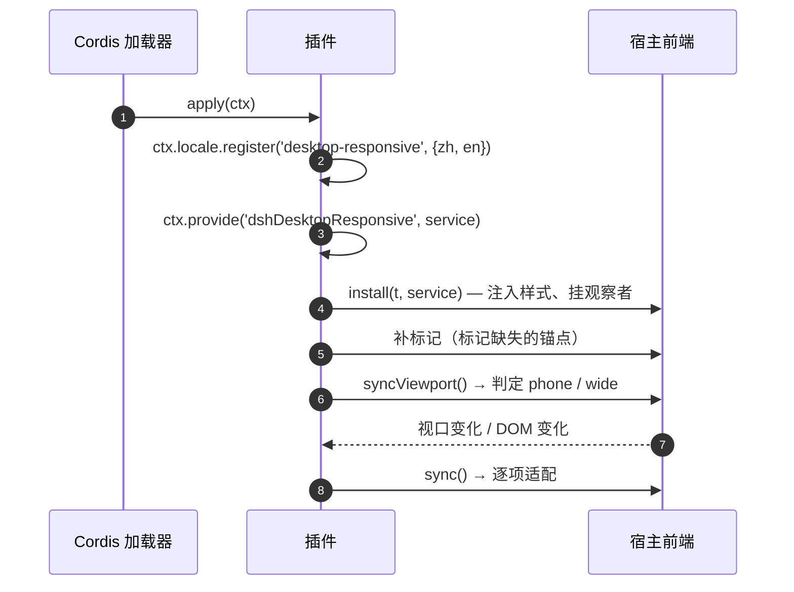

# PROJECTWIKI — dsh-desktop-responsive

> 本文件是本仓库的知识库。改代码前先读这里，改完同步更新这里和 `CHANGELOG.md`。
> 最后更新：2026-11-20

---

## 1. 项目概述

- **目标（Goal）**：让 DSH Desktop 与 DeepSeek Harness Web UI 在手机宽度下可用——侧栏变抽屉、设置变全屏页、输入区跟随键盘——而**不改上游一行代码**。
- **背景（Background）**：Harness 是桌面应用：侧栏 + 会话 + 右侧面板 + 底部输入区。在手机上这套布局必须变成别的东西。插件从外部做这件事：读布局、改几何、卸载时全部还原。
- **范围（In-Scope）**：浏览器侧布局适配；宿主标记契约；给从源码构建宿主的用户准备的最小上游补丁。
- **非目标（Out-of-Scope）**：不重写 Harness 的响应式能力；不做原生客户端（对比见 `docs/COMPARISON-native-client.md`）；不按类名选择宿主元素。
- **角色 / 干系人**：作者 `laiyinyizao007`；使用者是通过 DSH 插件目录或 npm 装插件的人。
- **运行环境 / 平台**：浏览器（DSH Desktop 的 Electron WebView，或 Harness Web UI 的普通标签页）；Node ≥ 20 仅用于跑测试。

---

## 2. 架构设计

插件只有两个文件有逻辑：`index.js` 是 Cordis 入口（服务端侧，什么也不做），`client.js` 是全部实现（浏览器侧）。

```mermaid
flowchart TD
  subgraph Host["宿主（Harness / DSH Desktop）"]
    Loader["Cordis 插件加载器"]
    Locale["@deepseek-ai/dsh-client-locale<br/>（peer 依赖，提供 locale 服务）"]
    Layout["@deepseek-ai/dsh-client-ui-layout<br/>（被适配的宿主前端）"]
  end

  subgraph Plugin["本插件"]
    Index["index.js<br/>Cordis 入口：name / inject / apply"]
    Client["client.js<br/>ANCHORS 表 + 适配逻辑 + 样式 + 服务"]
    Patch["patches/*.patch<br/>给从源码构建的宿主加 data-dsh-region"]
  end

  Loader --> Index
  Index -. 注入 client.js .-> Client
  Client -->|ctx.locale.register| Locale
  Client -->|按 ANCHORS 定位并改几何| Layout
  Patch -.仅从源码构建宿主时生效.-> Layout
  Client -->|ctx.provide('dshDesktopResponsive')| Other["其它插件"]
```

### 节点 ID ↔ 代码路径

| 节点 | 代码路径 |
| --- | --- |
| `Index` | `index.js` |
| `Client` | `client.js`（`ANCHORS` 表在 `client.js:232` 起） |
| `Patch` | `patches/@deepseek-ai+dsh-client-ui-*.patch` |
| `Locale` | 宿主提供；插件在 `client.js:3011` 调用 `ctx.locale.register` |

---

## 3. 架构决策记录（ADR）

目录：`docs/adr/`（MADR 模板）。

- [`20261103-never-select-by-hashed-class.md`](docs/adr/20261103-never-select-by-hashed-class.md) — 用标记与稳定属性定位宿主元素，绝不按哈希类名选择
- [`20261103-restore-react-owned-style.md`](docs/adr/20261103-restore-react-owned-style.md) — 卸载时还原宿主自己写的样式值
- [`20261120-peer-not-dependency.md`](docs/adr/20261120-peer-not-dependency.md) — 官方 `@deepseek-ai/*` 包用 peerDependencies 声明，范围带显式预发布分支

---

## 4. 设计决策 & 技术债务

### 已在设计里消化掉的坑

| 问题 | 处理方式 |
| --- | --- |
| 上游类名是哈希，每次构建都变 | 只按 `data-dsh-region` 标记与上游自带 `data-*` 属性定位（ADR-1） |
| 插件改写了 React 的网格值 | 记住原值，卸载时写回（ADR-2） |
| Harness 以预发布形式发布 | peer 范围带显式 `||` 预发布分支（ADR-3） |
| 宿主没有标记时会静默半失效 | 插件自行补标记；缺必需锚点时写诊断（`data-dshr-missing`） |
| 上游布局规则变了 | 漂移自检：`verifyLayout()` 周期性核对网格轨道数与内容宽度，不符则报警 |

### 已知技术债务

| 债务 | 优先级 | 说明 |
| --- | --- | --- |
| 可选锚点仍用语义类名（`.pc-root`、`.dshWbMarketHeaderText`） | 中 | 属第三方插件的私有实现，对方改名即失效；已标 `optional`，失效只记诊断 |
| 无截图 | 低 | 目录条目在仓库里声明 `screenshots.json` 后市场才能展示 App Store 式截图 |
| 无图标 | 低 | 目录条目不写 `icon:` 时回退到作者头像 |
| 上游补丁绑定 `0.2.1-rc.3` | 中 | 上游升版需重新生成补丁（`docs/UPSTREAM.md` 有流程） |

---

## 5. 模块文档

### `index.js` — Cordis 入口

- **职责**：让包成为一个合法的 Cordis 插件（加载器要求具名导出 + `apply`）。
- **入口 / 出口**：`export const name`、`export const inject = []`、`export function apply()`（空实现）。
- **外部依赖**：无。
- **风险**：无。服务端不参与布局。

### `client.js` — 浏览器侧实现

- **职责**：定位宿主元素 → 在手机宽度下改几何 → 提供服务 → 卸载时还原。
- **入口**：`exports.apply(ctx)`（`client.js:3010`）。`apply` 里做三件事：注册文案（`ctx.locale.register`）、提供服务（`ctx.provide('dshDesktopResponsive', …)`）、安装适配（`install(ctx.locale.bind(NS), service)`）。
- **注入**：`exports.inject = ['locale']`——需要宿主注入 `locale` 服务。
- **关键常量**：`PHONE_MAX = 640`（断点）、`NS = 'desktop-responsive'`（文案命名空间）、`ACTION_STRIP_MAX_PX = 232`。
- **关键数据结构**：`ANCHORS`（锚点表）——插件唯一的定位入口。
- **外部依赖**：`@deepseek-ai/dsh-client-locale`（peer，宿主提供）。
- **测试覆盖基线**：`test/responsive-layout-client.test.mjs`（行为测试，加载进 jsdom）与 `test/responsive-layout-contract.test.mjs`（契约守卫）。当前 83 通过 / 4 跳过。
- **风险与扩展点**：适配逻辑集中在 `install()` 内部的 `sync*()` 系列函数；新增一条适配 = 加一个锚点 + 一个 `sync*()` + 一条行为测试。

### `patches/` — 上游最小补丁

- **职责**：给从源码构建的宿主加上 `data-dsh-region` 标记，使设置对话框与会话表头也能被适配。
- **内容**：三个 `patch-package` 补丁，针对 `@deepseek-ai/dsh-client-ui-chat`、`-conversation`、`-settings-general` 的 `0.2.1-rc.3`。
- **约束**：只加属性，不改渲染结构。契约见 `docs/UPSTREAM.md`。

### `cordis.patch.yml` — 补丁层

```yaml
- insert:
    - id: dsh-desktop-responsive
      name: dsh-desktop-responsive
```

新增条目必须放在 `- insert:` 列表里；补丁层里顶层带 `id` 的条目是"修改已有条目"，找不到会警告。

---

## 6. API 手册

插件通过 `ctx.provide('dshDesktopResponsive', service)` 暴露一个服务，供其它插件查询当前布局能力。

### `registerAction(action)`

向折叠菜单里加一项。

| 参数 | 类型 | 说明 |
| --- | --- | --- |
| `action.id` | `string` | 稳定 id；同 id 的旧项被替换。非字符串或空串会抛错 |
| `action.label` | `string` | 无障碍名称；缺省用 `id` |
| `action.icon` | `string` | SVG 元素字符串；缺省为 `null` |
| `action.onSelect` | `Function` | 选中时回调；缺省为 `null` |

**返回**：`() => void`，移除该项。

### `listActions()`

**返回**：`Array<{id, label, icon, onSelect}>`，按注册顺序。

### `capabilities()`

**返回**：当前能力快照。

```js
{
  mode: 'phone' | 'wide',
  phone: boolean,
  drawer: true,
  usageSheet: true,
  collapsedActions: true,
  actionStrip: { maxWidth: 232 },   // CSS 像素
}
```

`mode` 是快照，不是承诺；用 `subscribe` 监听变化。

### `subscribe(listener)`

**参数**：`listener` — 每次变更后调用。
**返回**：`() => void`，取消监听。

### 兼容性策略

服务是插件提供的扩展点，不属于 Harness 契约的一部分。宿主或其它插件不得依赖其中的具体数值（`maxWidth` 等），只能按"存在/不存在"和能力布尔值使用。

---

## 7. 数据模型

本插件不持久化任何数据，也没有后端。

| 概念 | 载体 | 生命周期 |
| --- | --- | --- |
| 布局模式 | `data-dshr-mode` 属性（`phone` / `wide`），挂在 `documentElement` 上 | 随视口变化 |
| 锚点缺失诊断 | `data-dshr-missing` 属性 | 随布局重建 |
| 布局失效诊断 | `data-dshr-problem` 属性 + `console.error`（"the phone layout does not hold"） | `verifyLayout()` 周期性核对，异常时才写 |
| 适配失效诊断 | `data-dshr-drift` 属性 + `console.error`（"the layout for … stopped applying"） | `auditAdaptations()` 周期性核对，异常时才写 |
| 注册的动作 | 内存 `Map`（`id` → 动作） | 随插件生命周期 |
| 样式 | 一个 `<style>` 元素（键名 `dsh-desktop-responsive`）+ 一批 `data-dshr-*` 属性 | 卸载时移除 |

---

## 8. 核心流程

### 8.1 启动到可用



### 8.2 漂移自检

`VERIFY_INTERVAL_MS = 1000` 周期性跑 `verifyLayout()`：核对 frame 网格轨道数是否为 3、会话内容是否溢出。任一不符即写 `data-dshr-drift` 并打印一行诊断——**先找真实错误再下结论**，这条诊断就是上游规则变了的确证。

### 8.3 卸载

`install()` 返回的清理函数按序：摘掉事件监听 → 断开观察者 → 移除插件自己造出来的元素（遮罩、菜单、开关、用量表、动作条、抽屉背景）→ 移除 `documentElement` 上的 `data-dshr-mode` / `data-dshr-missing` / `data-dshr-problem` 与 frame 上的 `data-dshr-drawer` → **把记住的 React 原值写回 `grid-template-columns`** → 移除 `<style>` 元素。

注意最后一件事是有顺序依赖的：React 只在它认为值变了的时候重写样式，所以插件不能清空，只能写回。

---

## 9. 依赖图谱

| 依赖 | 类型 | 版本 | 许可证 | 说明 |
| --- | --- | --- | --- | --- |
| `@deepseek-ai/dsh-client-locale` | peer | `>=0.2.1-rc.1 <0.2.2 \|\| >=0.2.2-alpha.1 <0.3.0-0` | MIT | 提供 `locale` 服务，宿主自带 |
| `vitest` | dev | `^3.0.0` | MIT | 测试运行器 |
| `jsdom` | dev | `^26.0.0` | MIT | 测试用 DOM |

- **运行时依赖：无。** 插件的 tarball 18 个文件、71.6 kB（`npm pack --dry-run` 实测）。
- **潜在冲突**：`@deepseek-ai/*` 是宿主单例，不要放进 `dependencies`（见 ADR-3）。
- **可替代方案**：无——`locale` 服务由 Harness 定义。

---

## 10. 维护建议

- **发布**：`npm publish`（`publishConfig.registry` 已钉到 `registry.npmjs.org`）→ 打 tag `vX.Y.Z` → 在 `awesome-dsh-plugin/awesome-dsh-plugin` 提 `data/plugins/<owner>__<repo>.yml`。仓库需要 `dsh-plugin` topic。
- **上游升级**：重新生成 `patches/`（`docs/UPSTREAM.md` 有流程），并在 `ANCHORS` 里核对标记是否改名。
- **新增一条适配**：加锚点 → 加 `sync*()` → 加行为测试 → 更新本文件的模块表与 `CHANGELOG.md`。
- **跑测试**：`npm install --include=dev && npm test`。`--include=dev` 不是形式主义：`NODE_ENV=production` 的机器上 npm 会跳过 devDependencies，测试运行器正是其中之一。
- **换 harness 版本后**：重跑安装，确认没有 `ERESOLVE`（peer 范围的预发布分支，见 ADR-3）。

---

## 11. 术语表和缩写

| 术语 | 定义 |
| --- | --- |
| 宿主（host） | 装了本插件的 Harness / DSH Desktop |
| 标记（marker） | 宿主元素上的 `data-dsh-region` 属性，是插件的定位契约 |
| 锚点（anchor） | `ANCHORS` 表里的一项：一个选择器 + 来源 + 所属宿主包 + 是否必需 |
| 漂移（drift） | 上游布局规则变了，插件的适配不再成立 |
| 抽屉（drawer） | 手机宽度下浮在内容之上的侧栏 |
| 单例（host singleton） | Harness 保证只存在一份实现的包，如 `@deepseek-ai/*` |

---

## 12. 变更日志

参见 [`CHANGELOG.md`](CHANGELOG.md)（与本节建立双向链接）。

---

## 13. 项目智慧库

> 来源：`.claude/memory/lessons-learned.md`；当前状态另见 `.claude/memory/context.md`，工具用法见 `.claude/memory/tool-patterns.md`

### 关键实现路径

- 锚点表 → `sync*()` 系列 → 样式键 → 卸载还原，是本插件的固定骨架。

### 项目特定模式

- 宿主契约优先于实现细节：能加标记就不改结构；能不按类名就不按类名。

### 已知挑战

- 上游预发布版本号变化快，peer 范围要留 `||` 分支。

---

## 14. 错误知识库

> 来源：`.claude/memory/error-knowledge.md`

### 已知错误索引

- 参见 [error-knowledge.md](.claude/memory/error-knowledge.md)

### 预防检查清单

- 插件源码里不得出现哈希类名形态（`test/responsive-layout-contract.test.mjs` 有守卫）。
- 卸载必须还原 React 自己的样式值，不能清空。

---

## 15. 快速排障指南（Troubleshooting）

### 常见报错速查

| 报错特征 | 可能原因 | 快速检查 | 解决方案 |
| --- | --- | --- | --- |
| 装了但布局没变 | 必需锚点缺失 | 看 `data-dshr-missing` 属性 | 宿主太旧或上游改标记名；见 `docs/UPSTREAM.md` |
| 诊断："the phone layout does not hold: the frame grid has 4 tracks, expected 3" | 上游网格规则变了 | 看 `data-dshr-problem` 属性 | 更新 `ANCHORS` / `syncGrid()` |
| 诊断："the settings dialog and the conversation header were not adapted" | 宿主没打补丁 | 看宿主构建是否用了 `patches/` | 从源码构建宿主时应用补丁 |
| 诊断："the layout for project-console stopped applying" | 第三方插件改名/升级 | 看 `data-dshr-drift` 属性 | 可选表面失效不影响其它适配 |
| 安装报 `ERESOLVE` | peer 范围排除了宿主版本 | `npm view @deepseek-ai/dsh-client-locale` | 见 ADR-3 的范围写法 |
| 安装 90 秒后 `exit=1` 且无报错 | DSH 安装器硬超时 | 看 `profiles\web\.dsh-market\log.ndjson` | 本插件很小（71.6 kB、无运行时依赖），不是超时原因；大依赖才会 |

### 环境问题排查

```bash
node --version          # ≥ 20
npm install --include=dev
npm test
```

### 详细错误知识库

- 完整错误索引：[error-knowledge.md](.claude/memory/error-knowledge.md)
- 每次改动前过一遍那里的「预防检查清单」
